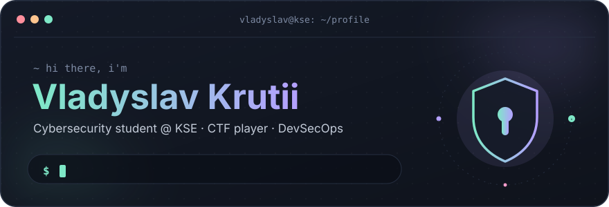
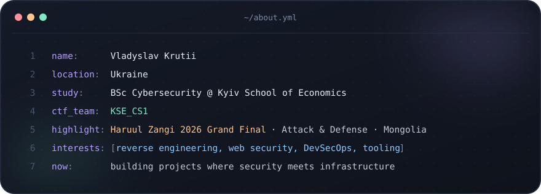
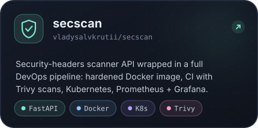
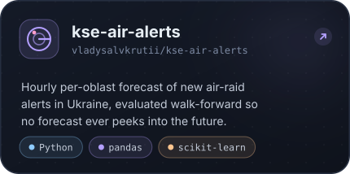
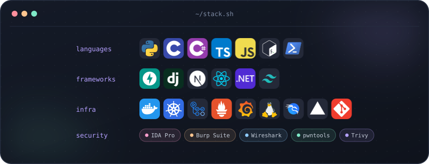

  

  

  

<h3 align="center"><code>~/projects</code></h3>

  
  

<h3 align="center"><code>~/stack</code></h3>

  

<h3 align="center"><code>~/stats</code></h3>

  
  

  

  <picture>
    <source media="(prefers-color-scheme: dark)" srcset="https://raw.githubusercontent.com/vladysalvkrutii/vladysalvkrutii/output/snake-dark.svg" />
    
  </picture>

  

